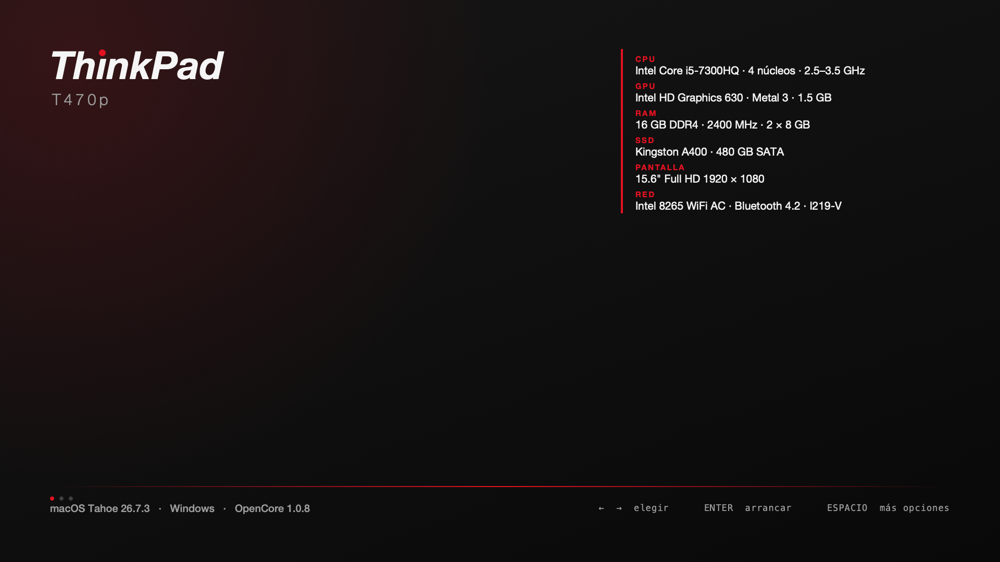

<p align="center">
  
</p>

<h1 align="center">ThinkPad T470p · macOS Tahoe 26 · OpenCore 1.0.8</h1>

<p align="center">
  Hackintosh en dual boot con Windows, hecho y probado en una Lenovo ThinkPad T470p (20J7).<br>
  WiFi nativo, audio, Bluetooth, HDMI, lector SD, CPU en modo rendimiento y escritura en NTFS.
</p>

---

## ⚡ Instalación en un comando

Arma la EFI con **tu propio** número de serie y baja macOS Tahoe directo de Apple. No formatea nada.

**macOS / Linux**
```bash
curl -fsSL https://raw.githubusercontent.com/z-XOF-z/thinkpad-t470p-hackintosh/main/instalar.py | python3 -
```

**Windows (PowerShell)**
```powershell
irm https://raw.githubusercontent.com/z-XOF-z/thinkpad-t470p-hackintosh/main/instalar.py -OutFile instalar.py; py instalar.py
```

Al terminar tienes la carpeta `USB-T470p/` con `EFI/` y `com.apple.recovery.boot/`. Cópialas a una USB en FAT32 y sigue la [guía de instalación](docs/instalacion.md).

> Opciones: `--mac AA:BB:CC:DD:EE:FF` (usa la MAC de tu Ethernet como ROM, recomendado), `--sin-macos`, `--salida CARPETA`.

---

## 💻 Equipo

| | |
|---|---|
| **Modelo** | Lenovo ThinkPad T470p (20J7), BIOS R0FET61W 1.41 |
| **CPU** | Intel Core i5-7300HQ (Kaby Lake, 4 núcleos, 2.5–3.5 GHz) |
| **Gráfica** | Intel HD Graphics 630 (8086:591B) — sin NVIDIA |
| **RAM** | 16 GB DDR4 2400 MHz |
| **Disco** | Kingston A400 480 GB SATA (Windows + macOS 80 GB) |
| **Pantalla** | 15.6" Full HD 1920×1080 |
| **Red** | Intel Wireless-AC 8265 + Bluetooth · Intel I219-V5 |
| **Audio** | Realtek ALC298 |
| **SMBIOS** | MacBookPro16,2 |

## ✅ Qué funciona

| Componente | Estado | Cómo |
|---|---|---|
| Gráfica HD 630 | ✅ Metal 3, aceleración completa | WhateverGreen, `ig-platform-id 0x591B0000` |
| HDMI | ✅ detecta al arrancar | parche `con1` + `igfxonln=1` |
| WiFi | ✅ **nativo** (icono de WiFi de macOS, Ubicación) | AirportItlwm Tahoe 2.4.0 |
| Bluetooth | ✅ AirPods, iPhone, bocinas | IntelBluetoothFirmware 2.5.3 + BlueToolFixup |
| Audio (bocina, audífonos, micrófono) | ✅ | AppleALC layout **29** + AppleHDA por root patch (OCLP-Mod) |
| Apple Music / DRM | ✅ | `unfairgva=7` |
| Teclado y touchpad | ✅ gestos, clic derecho con dos dedos | VoodooPS2 2.3.7 |
| Botones del TrackPoint | ⚠️ apagados a propósito | congelaban el puntero (también pasa en Linux) |
| Teclas Fn de ThinkPad | ✅ F7 proyectar, F9 ajustes, F10 BT, ⭐ abre VS Code | YogaSMC + YogaSMCNC |
| Ventilador | ✅ control Auto / Full | YogaSMC + `SSDT-ECRW` |
| CPU | ✅ XCPM, turbo rápido | CPUFriend (EPP 0x20) |
| Batería | ✅ %, ciclos, salud | SMCBatteryManager |
| Lector SD (RTS522A) | ✅ | RealtekCardReader 0.9.8 |
| USB 2/3 | ✅ mapa propio | USBToolBox + UTBMap |
| Disco de Windows (NTFS) | ✅ lectura y escritura | macFUSE 5.5 + ntfs-3g |
| iCloud, App Store, iMessage | ✅ | SMBIOS propio |
| Suspensión | ✅ | `hibernatemode 0` |
| AirDrop iPhone → Mac, Handoff | ❌ | el chip Intel no tiene AWDL; necesita Broadcom BCM94360NG |
| Lector de huella | ❌ | sin driver |
| Ethernet | 🔧 en revisión | IntelMausi carga, sin enlace todavía |

## 🗂️ Qué hay en este repo

```
EFI/                     OpenCore 1.0.8 listo para la T470p (sin datos únicos)
instalar.py              instalador de un comando (EFI + SMBIOS + macOS Tahoe)
portada.png              el fondo del menú de arranque
docs/
  instalacion.md         particiones, BIOS, instalación y post-instalación paso a paso
  bitacora.md            todo lo que se hizo, con fechas, respaldos y cómo deshacer cada cambio
  windows.md             lo que se hizo desde Windows (particiones, USB, mapa USB)
scripts/macos/           scripts usados en macOS (WiFi, audio, montaje NTFS, menú, teclado...)
extras/                  SSDT-ECRW, fondo del menú, distribución de teclado latinoamericana, TeclaWindows
```

## 🎨 Menú de arranque

Tema GoldenGate de OpenCanopy con fondo propio (`EFI/OC/Resources/Image/Acidanthera/GoldenGate/Background.icns`).
El fondo se genera con [`extras/menu-arranque/fondo.swift`](extras/menu-arranque/fondo.swift).
En desarrollo: panel **EN VIVO** dentro del menú con temperatura, frecuencia y consumo del CPU en tiempo real.

## ⚠️ Antes de empezar

- Esto es para la **T470p**. En otro equipo hay que rehacer el mapa USB, el `layout-id` del audio y el framebuffer.
- **Nunca uses el número de serie de otra persona.** `instalar.py` te genera uno propio.
- Tahoe en Kaby Lake no es oficial: el audio necesita el root patch de **OCLP-Mod** y se pierde en cada actualización de macOS (ver `docs/instalacion.md`).
- Haz respaldo de tus datos. Las particiones se hacen desde Windows con cuidado (guía incluida).

## 🙏 Créditos

[Acidanthera](https://github.com/acidanthera) (OpenCore, Lilu, WhateverGreen, AppleALC, VirtualSMC, VoodooPS2, CPUFriend, IntelMausi) ·
[OpenIntelWireless](https://github.com/OpenIntelWireless) y [laobamac](https://github.com/laobamac) (itlwm/AirportItlwm, OCLP-Mod) ·
[zhen-zen](https://github.com/zhen-zen/YogaSMC) (YogaSMC) · [0xFireWolf](https://github.com/0xFireWolf/RealtekCardReader) (lector SD) ·
[USBToolBox](https://github.com/USBToolBox) · [macFUSE](https://github.com/macfuse/macfuse) · [Tuxera ntfs-3g](https://github.com/tuxera/ntfs-3g) ·
[Dortania](https://dortania.github.io/OpenCore-Install-Guide/) (guías) · EFI base de [hfoky/ThinkPad-T470s-OpenCore-configuration](https://github.com/hfoky/ThinkPad-T470s-OpenCore-configuration).

Los kexts y OpenCore conservan sus propias licencias. Los scripts y documentos propios de este repo están bajo licencia MIT.

---

<p align="center">Hecho por <b>Andrew (XOF)</b> · noviembre 2026</p>
